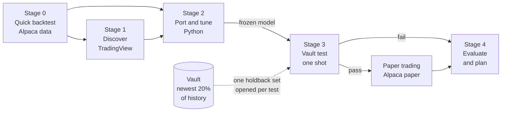

# 1. Overview — What Gauntlet Is and What It Does

[← Intro index](README.md) · Next: [2. Architecture →](02-architecture.md)

---

## In one sentence

**Gauntlet** is a system for finding out whether a trading idea really works before any real money is used. Every idea has to pass a series of tests, so ideas that only look good on past data get filtered out.

## The problem it solves

You can make almost any idea look good on past data by tuning it. Change the settings enough times and something will look profitable by luck. When a strategy like that trades for real, the "edge" disappears. This is called **overfitting**.

Gauntlet protects against overfitting in four ways:

| Protection | What it means in practice |
|---|---|
| **Write the test before the result** | You write down what you expect, with numbers, *before* running a backtest. The result then passes or fails against that. |
| **Lock away unseen data** | The most recent 20% of price history goes into a locked **vault**. No tuning decision ever sees it. Each finished model is tested on the vault once. |
| **Count every attempt** | Every variant you try is logged. The more you try, the higher the bar a result has to clear. |
| **Paper trade before real money** | Models that pass the vault trade with fake money on live data for 1–3 months. Only then are real trades considered. |

## What Gauntlet does, step by step

Stage 4's decision feeds the next iteration: a revised model goes back to Stage 2, and a new idea starts again at Stage 0. If the vault holds more than one holdback set, a fine-tuned model is tested on the next unopened set. See [Multiple holdback sets](02-architecture.md#multiple-holdback-sets).

| Stage | Question it answers | Where it runs |
|---|---|---|
| **0 — Quick backtest** | Does the idea, exactly as written and untuned, make any money after costs? | Python on Alpaca historical data |
| **1 — Discover** | Is this idea worth building properly? | TradingView (Pine Script) |
| **2 — Port and tune** | Does a version we fully control reproduce it, and which settings work across many periods? | Python / Databricks |
| **3 — Vault test** | Does the frozen model still work on data no decision has seen? | Python, on the next unopened holdback set |
| **Paper trading** | Does it work on new data with realistic orders? | Alpaca paper account |
| **4 — Evaluate** | Promote, keep paper trading, revise, or retire? | You decide, using one scorecard |

Stage 0's pass gate is still a proposal: enough trades and positive expectancy after costs.

## Where things live

| Place | What it holds |
|---|---|
| **GitHub — [GauntletBot/trading-strategies](https://github.com/GauntletBot/trading-strategies)** | The source of truth. Every bot is a folder of plain-text files: what the strategy does, which data it uses, how it runs, and every test result. |
| **Databricks** | Market data tables (catalog `gauntlet`), backtest jobs, and MLflow experiment tracking. |
| **Alpaca** | Historical market data, and later paper trading and live trading. |
| **TradingView** | Fast visual exploration of ideas in Stage 1. |
| **Notion — Trading Bot Optimizer** | Plans, decisions and the iteration log. |

## Key numbers

| Item | Value |
|---|---|
| Vault | Newest 20% of history: one holdback set by default, or several, each after its own embargo gap |
| Maximum drawdown allowed by the gates | 25% |
| Minimum trades for a result to count | 100 (fewer than 30 proves nothing) |
| Paper trading period | 1–3 months |
| Files per bot | 5 (3 required, 2 added as you test) |

## What exists today (November 2026)

| Part | Status |
|---|---|
| Strategy repo, 5 file types, templates, CI checks | **Built** |
| Example bots: `demo-bot`, `sma-crossover`, `rsi-reversion`, `vwap-scalp` | **Built** (the demo's results are sample values for illustration) |
| Databricks catalog `gauntlet`, schema `gauntlet_bot_demo` | **Set up** |
| TradingView harness and trade analyzer (`harness_v1.pine`, `analyze_trades.py`) | **Built** |
| Gauntlet core in Python: milestone M0 (interfaces, run config, vault lock) | **Built** |
| Data ingestion, simulated broker, walk-forward tuner, vault runner, paper runner, scorecard (M1–M6) | **Planned** |
| Databricks backtest job and MLflow logging | **Documented** in each `bot.md`; the job code is not in this repo |

---

[← Intro index](README.md) · Next: [2. Architecture →](02-architecture.md)
