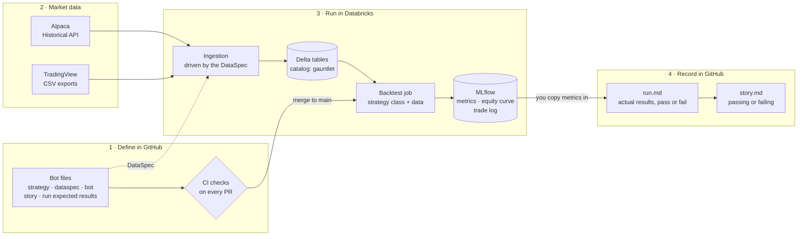
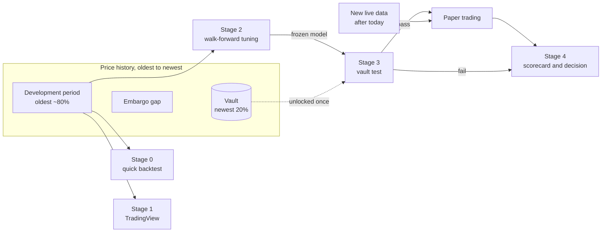
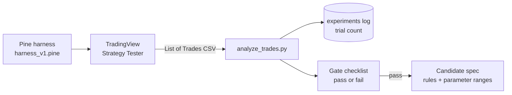
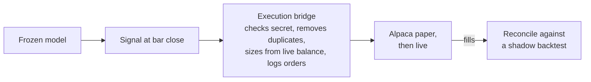

# 2. System Architecture and Data Flows

[← 1. Overview](01-overview.md) · [Intro index](README.md) · Next: [3. Getting Started →](03-getting-started.md)

---

## The big picture

Gauntlet has four layers. Each one has a single job.

| Layer | Job | Tools |
|---|---|---|
| **Definition** | Describe each bot in plain text: what it trades, on which data, and what results you expect | GitHub repo, CI checks |
| **Data** | Fetch, clean and store market prices | Alpaca Historical API, TradingView CSV exports, Databricks Delta tables |
| **Execution** | Run backtests and record the results | Databricks jobs, vectorbt, MLflow |
| **Trading** | Forward-test with fake money, then trade small with real money | Alpaca paper, then live |

## Data flow 1 — from idea to recorded result

This is the path every backtest takes.



Reading the diagram, step by step:

1. **You write the bot's files** in a folder in GitHub.
2. **CI checks them** on every pull request. It checks names, required sections, and that expected results are filled in before any actual results.
3. **The DataSpec drives ingestion.** It names the symbols, dates, bar size and data feed. Prices are fetched from Alpaca (or loaded from TradingView CSV exports) and stored as Delta tables in the `gauntlet` catalog.
4. **Merging to `main` triggers the Databricks backtest job.** The job loads the strategy's Python class and the data named by the DataSpec.
5. **Results go to MLflow:** metrics such as return, Sharpe and drawdown, plus the equity curve and the trade log.
6. **You copy the metrics into the run file** and mark each one pass or fail.
7. **The story is updated:** it is `passing` only if every acceptance criterion is met.

## Data flow 2 — the validation stages

This shows how data is split so tuning never sees the vault.



- **Development period:** everything you explore and tune on.
- **Embargo gap:** a buffer at least as long as the model's longest lookback. It stops indicator values from leaking across the boundary.
- **Vault:** opened once per frozen model. If you change the model after seeing the vault result, the vault is "burned" for that idea, and paper trading becomes the only clean test left.
- **Paper trading:** uses data that didn't exist when the model was frozen.

## Data flow 3 — Stage 1 in TradingView



The analyzer computes bootstrap confidence intervals, Monte Carlo drawdown, Deflated Sharpe and year-by-year stability. Every variant you try is logged, because the trial count raises the bar for the Deflated Sharpe gate.

## Data flow 4 — live trading (future)



Every live trade gets a backtest twin, so you can see when live results drift from what the backtest predicted.

## The swappable parts inside the Gauntlet core

The Python core is built from small parts with fixed jobs. Any part can be replaced by editing a YAML run config, without changing the code.

| Part | Job | First version |
|---|---|---|
| `DataProvider` | Returns standard price bars for a symbol, bar size and date range | Alpaca, CSV import |
| `Splitter` | Sets development, embargo and vault dates and walk-forward folds; refuses vault data without a frozen model ID | Time-based splits |
| `Model` | Learns from past bars and outputs a target position from −1 (short) to +1 (long) | `RuleModel`: rules plus a parameter search |
| `Sizer` | Turns a target position into a number of shares | Risk-based sizing with caps |
| `Broker` | Executes orders and reports fills | `SimBroker` for backtests, `AlpacaPaperBroker` for paper trading |
| `Evaluator` | Computes metrics and applies the gates | Ported `analyze_trades.py` |
| `Registry` | Logs every run with its config, code version, metrics and trial count | DuckDB table |

Because a `Model` only outputs a target position, a machine-learning model can later replace the rule-based one. Sizing, costs, execution and grading stay the same, so the two are judged on equal terms.

## Repository layout

```
trading-strategies/
├── README.md
├── docs/                    ← reference docs, templates, this intro
├── scripts/                 ← CI validation scripts
├── dev/{username}/{category}/{bot-name}/       ← your sandbox
├── staging/{username}/{category}/{bot-name}/   ← team review
└── prod/{username}/{category}/{bot-name}/      ← paper and live
```

| Environment | Who merges | Requirement to enter |
|---|---|---|
| `dev/` | You | CI passes |
| `staging/` | 1 team approval | Databricks backtest passes, story is `passing` |
| `prod/` | 2 approvals | CI passes, paper-trading results attached, every story `passing` |

---

[← 1. Overview](01-overview.md) · [Intro index](README.md) · Next: [3. Getting Started →](03-getting-started.md)
