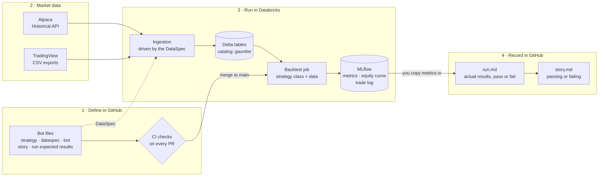
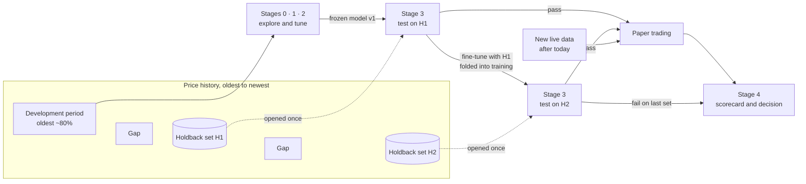
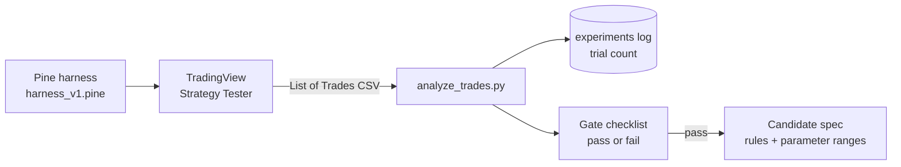
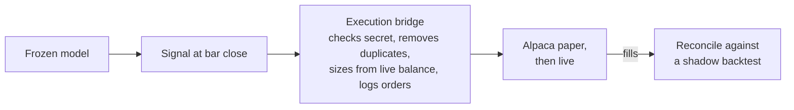

# 2. System Architecture and Data Flows

[← 1. Overview](01-overview.md) · [Intro index](README.md) · Next: [3. Getting Started →](03-getting-started.md)

---

## The big picture

Gauntlet has four layers. Each one has a single job.

| Layer | Job | Tools |
|---|---|---|
| **Definition** | Describe each bot in plain text: what it trades, on which data, and what results you expect | GitHub repo, CI checks |
| **Data** | Fetch, clean and store market prices | Alpaca Historical API, TradingView CSV exports, Databricks Delta tables |
| **Execution** | Run backtests and record the results | Databricks jobs, vectorbt, MLflow |
| **Trading** | Forward-test with fake money, then trade small with real money | Alpaca paper, then live |

## Data flow 1 — from idea to recorded result

This is the path every backtest takes.



Reading the diagram, step by step:

1. **You write the bot's files** in a folder in GitHub.
2. **CI checks them** on every pull request. It checks names, required sections, and that expected results are filled in before any actual results.
3. **The DataSpec drives ingestion.** It names the symbols, dates, bar size and data feed. Prices are fetched from Alpaca (or loaded from TradingView CSV exports) and stored as Delta tables in the `gauntlet` catalog.
4. **Merging to `main` triggers the Databricks backtest job.** The job loads the strategy's Python class and the data named by the DataSpec.
5. **Results go to MLflow:** metrics such as return, Sharpe and drawdown, plus the equity curve and the trade log.
6. **You copy the metrics into the run file** and mark each one pass or fail.
7. **The story is updated:** it is `passing` only if every acceptance criterion is met.

## Data flow 2 — the validation stages and the vault

This shows how price history is split so tuning never sees the data it will be judged on.



- **Development period:** everything you explore and tune on.
- **Vault:** the newest 20% of history, locked before any exploration. It can be **one holdback set** (the default) or be split into **several holdback sets**, H1, H2, H3 and so on, in time order.
- **Embargo gap:** a buffer at least as long as the model's longest lookback. There is one before **every** holdback set, so indicator values can't leak from training data into the set being tested.
- **Paper trading:** uses data that didn't exist when the model was frozen.

### Multiple holdback sets

With one holdback set, you get one honest test. If you change the model after seeing that result, the vault is "burned" and paper trading is the only clean test left.

Several holdback sets let you **fine-tune and test again** without fooling yourself:

1. **Tune** on the development period, then freeze model **v1**.
2. **Test v1 once on H1.**
3. **Fine-tune.** H1 has now been seen, so it may join the training data. Retune on development + H1, then freeze model **v2**.
4. **Test v2 once on H2.** H2 is newer than everything v2 was trained on, and the gap before it stops leakage.
5. **Repeat** until the sets run out. The last set opened gives the result you report.

#### Rules

| Rule | Why |
|---|---|
| The sets, their sizes and the gaps are fixed **before Stage 1**, and frozen with the other split dates | Choosing them after seeing results would let the results shape the test |
| Sets are opened **in time order, oldest first**; none can be skipped | Training data must always be older than the set it's tested on |
| Each set is opened **once**, by one frozen model, and every opening is logged | A set used twice is no longer unseen |
| A model may **train on** a set that has been opened, never **test on** one | An opened set is ordinary training data from then on |
| Every fine-tuning round counts toward the **trial count** | More attempts raise the bar for the Deflated Sharpe gate |
| A model that passes any set may go to paper trading; one that fails the **last** set goes to Stage 4 | Paper trading stays the final clean test |

#### Choosing sizes

- **Default:** one set covering the whole 20%. This is how Gauntlet worked before.
- **Splitting** buys extra test rounds but makes each set smaller. A smaller set holds fewer trades, so its result is less certain.
- **Make each set long enough for at least 30 trades** at the strategy's normal trading rate. Aim for 100. A set below 30 can't pass or fail anything meaningfully.
- Put the **largest set first** if you expect to fine-tune once, so the most important test has the most data. Later sets can be smaller.

#### Example split configuration

```yaml
# splits.yaml — frozen with `gauntlet splits freeze` before Stage 1
development_fraction: 0.80        # oldest 80% of history
embargo: longest_lookback         # a gap before every holdback set
holdback_sets:                    # newest 20%, in time order
  - id: H1
    fraction: 0.10                # first test, the largest
  - id: H2
    fraction: 0.05                # after one round of fine-tuning
  - id: H3
    fraction: 0.05                # after a second round
```

The `Splitter` works out each set's dates from these fractions, places the gaps, and refuses to return a set's data unless a frozen model ID is given and every older set has been opened.

## Data flow 3 — Stage 1 in TradingView



The analyzer computes bootstrap confidence intervals, Monte Carlo drawdown, Deflated Sharpe and year-by-year stability. Every variant you try is logged, because the trial count raises the bar for the Deflated Sharpe gate.

## Data flow 4 — live trading (future)



Every live trade gets a backtest twin, so you can see when live results drift from what the backtest predicted.

## The swappable parts inside the Gauntlet core

The Python core is built from small parts with fixed jobs. Any part can be replaced by editing a YAML run config, without changing the code.

| Part | Job | First version |
|---|---|---|
| `DataProvider` | Returns standard price bars for a symbol, bar size and date range | Alpaca, CSV import |
| `Splitter` | Sets development dates, holdback sets, embargo gaps and walk-forward folds; opens holdback sets oldest first, once each, only for a frozen model | Time-based splits |
| `Model` | Learns from past bars and outputs a target position from −1 (short) to +1 (long) | `RuleModel`: rules plus a parameter search |
| `Sizer` | Turns a target position into a number of shares | Risk-based sizing with caps |
| `Broker` | Executes orders and reports fills | `SimBroker` for backtests, `AlpacaPaperBroker` for paper trading |
| `Evaluator` | Computes metrics and applies the gates | Ported `analyze_trades.py` |
| `Registry` | Logs every run with its config, code version, metrics and trial count | DuckDB table |

Because a `Model` only outputs a target position, a machine-learning model can later replace the rule-based one. Sizing, costs, execution and grading stay the same, so the two are judged on equal terms.

## Repository layout

```
trading-strategies/
├── README.md
├── docs/                    ← reference docs, templates, this intro
├── scripts/                 ← CI validation scripts
├── dev/{username}/{category}/{bot-name}/       ← your sandbox
├── staging/{username}/{category}/{bot-name}/   ← team review
└── prod/{username}/{category}/{bot-name}/      ← paper and live
```

| Environment | Who merges | Requirement to enter |
|---|---|---|
| `dev/` | You | CI passes |
| `staging/` | 1 team approval | Databricks backtest passes, story is `passing` |
| `prod/` | 2 approvals | CI passes, paper-trading results attached, every story `passing` |

---

[← 1. Overview](01-overview.md) · [Intro index](README.md) · Next: [3. Getting Started →](03-getting-started.md)
